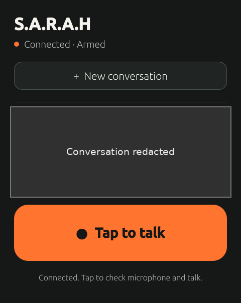

# Sarah · Android + Ubuntu Touch / R1

A voice companion for conversations and everyday tasks. Tap the microphone, ask a question, hear a reply, and keep the conversation going. On Android, you can also opt in to **“Hey Sarah”** wake-word detection.

Sarah connects your device to a **self-hosted HTTPS voice bridge**. The shared bridge handles transcription, AI conversation, speech generation, and any tools you choose to enable. You need your own configured backend; this is not a standalone or fully offline AI assistant.

[Download Android](https://github.com/serexe/sarah-android/releases/latest) · [Get started](#get-started) · [Android source](android/README.md) · [Ubuntu Touch setup](docs/SETUP.md#native-client) · [Security](SECURITY.md)

## Project home and releases

**[serexe/sarah-r1](https://github.com/serexe/sarah-r1) is the maintained home for Sarah source, documentation, issues, and future releases across Android and Ubuntu Touch / R1.** Start new development here: Android source lives in `android/`; the shared bridge and native client live alongside it.

The original [sarah-android repository](https://github.com/serexe/sarah-android) is retained as a read-only historical archive. Its [existing Android releases](https://github.com/serexe/sarah-android/releases), branches, tags, screenshots, and provenance records stay there; they have not been copied or reissued here. The download links below intentionally point to those historical APKs. Future releases belong to [this repository's releases](https://github.com/serexe/sarah-r1/releases); consolidation itself does not publish a new build or validate the imported Android snapshot.

## What you can do

- **Talk naturally:** tap to speak, listen to spoken replies, and ask follow-up questions.
- **Choose your device:** Kotlin/Compose on Android, or native Qt/QML on an R1 running Ubuntu Touch.
- **Use an optional Android wake word:** on-device “Hey Sarah” detection, with a foreground-service notification and an explicit Stop control. The Ubuntu Touch client is tap-to-talk only; it has no wake word or background listening mode.
- **Ask for help with your home, notes, or calendar:** enable supported tools through your backend, with only the access you configure. Integrations are off by default, not connected out of the box.
- **Keep service credentials on your server:** pair using an HTTPS bridge address and revocable device token, not your AI-provider or smart-home credentials. Protect local pairing data and transcripts too.

For example, ask “Turn on the kitchen lights,” “Add milk to my notes,” or “What is on my calendar today?” These need the corresponding backend integrations and permissions.

## Choose a client

| Platform | Available today | Release and validation limits |
| --- | --- | --- |
| Android 8.0+ | Tap-to-talk, spoken replies, optional on-device “Hey Sarah” | [Stable golden30 APK](https://github.com/serexe/sarah-android/releases/tag/sarah-golden-v30): local-review/debug-signed, not a production-signed consumer release. [Exact APK identity and proof limits](https://github.com/serexe/sarah-android/blob/main/SARAH_BASELINE.md). |
| Ubuntu Touch / R1 | Native Qt 5/QML client, tap-to-talk, transcript and reply playback | Experimental sanitized source candidate. Build/package it yourself; no public device binary or device-verified release is supplied. [Setup](docs/SETUP.md#native-client) · [Verification](docs/VERIFICATION.md). |

The Android **v31 Command Center UI** remains a [separate review branch](https://github.com/serexe/sarah-android/tree/ui/command-center-review), not the stable golden30 release and not the Android snapshot in this repository.

**Repository scope:** `android/` contains a 94-file sanitized source snapshot, not a full migration of the Android repository, its history, branches, tags, release assets, screenshots, or technical publication records. No tested APK/source linkage or build validation is asserted for that snapshot; see [snapshot scope](android/SOURCE-SNAPSHOT.md). Existing Android downloads and supporting records remain in [sarah-android](https://github.com/serexe/sarah-android).

## Screenshots

<p align="center">
  
  
</p>

Actual **Android v31 review** APK screens: unpaired setup and Settings, **not stable golden30**. The paired conversation/Command Center screen has not been captured. [Screenshot provenance and limits](https://github.com/serexe/sarah-android/blob/main/docs/screenshots/V31-CAPTURE.md). Images remain hosted in the Android repository; they were not migrated here.

<p align="center">
  
</p>
<p align="center"><sub>Actual R1 screenshot from an earlier development build. System bar cropped; conversation visibly redacted for privacy. Not a mockup or proof that this public source candidate has been installed.</sub></p>

## Get started

1. **Run your bridge.** Follow [bridge setup](docs/SETUP.md#bridge) and [configuration](docs/CONFIGURATION.md). Both clients use the shared bridge. The legacy Codex backend remains default; the optional [scoped Hermes ACP backend](docs/ACP.md) must be selected and provisioned explicitly.
2. **Choose and pair your client.** On Android, [install the stable APK](https://github.com/serexe/sarah-android/releases/latest), enter your HTTPS bridge address and device token, and import your CA certificate only if required. On Ubuntu Touch, follow [native build/setup](docs/SETUP.md#native-client); do not install an Android APK on Ubuntu Touch. Keep provider and integration credentials server-side.
3. **Start talking.** Grant microphone permission and tap to speak. On Android only, enable “Hey Sarah” if wanted and use Stop to turn it off. Wake-word detection runs on-device; transcription, AI replies, and speech generation depend on the backend.

**Android wake limits:** screen-off successive wakes and physical-phone Stop behavior still need validation; tap-to-talk remains the fallback. Local reset does not delete server history. **Tool permissions:** enabling Home Assistant permits discovered services available to its token, including potentially sensitive actions, without repeated confirmation. The retained confirmation screen is not a mandatory approval policy. Cancellation cannot undo an already dispatched action. Review [security](SECURITY.md) and [permissions](docs/CONFIGURATION.md) before connecting real accounts. Transcripts, audio and rollback exports need your own private retention policy; no automatic cleanup scheduler is included.

## Documentation

- **Android in this repository:** [source/setup limits](android/README.md) · [snapshot provenance](android/SOURCE-SNAPSHOT.md) · [dependencies](android/DEPENDENCIES.md) · [wake-word runtime/model](android/KWS-DEPENDENCIES.md).
- **Original Android project records:** [development, signing and technical limits](https://github.com/serexe/sarah-android/blob/main/docs/DEVELOPMENT.md) · [stable APK baseline](https://github.com/serexe/sarah-android/blob/main/SARAH_BASELINE.md) · [third-party notices](https://github.com/serexe/sarah-android/blob/main/THIRD-PARTY-NOTICES.md) · [covered-source information](https://github.com/serexe/sarah-android/blob/main/COVERED-SOURCE.md).
- **Shared bridge and Ubuntu Touch:** [setup](docs/SETUP.md) · [configuration](docs/CONFIGURATION.md) · [architecture](docs/ARCHITECTURE.md) · [ACP backend](docs/ACP.md) · [security](SECURITY.md) · [verification](docs/VERIFICATION.md).

[Report an issue](https://github.com/serexe/sarah-r1/issues). Do not include tokens, private certificates, recordings, or personal transcripts.

## What does S.A.R.A.H mean?

**Self Actuated Residential Automated Habitat** — a nod to SARAH, the smart house from the TV series *Eureka*. This Sarah lives on Android and Ubuntu Touch / R1 rather than in a house.

## Ubuntu Touch / R1 technical reference

The details below describe the native Ubuntu Touch client and shared bridge, not Android APK release validation. Android-specific behavior and snapshot limits are documented above and in [android/README.md](android/README.md).

## Why this exists

Sometimes a dedicated button and a short spoken answer are enough. The Ubuntu Touch client explores that idea with a small native interface: one large talk button, a visible conversation, and a bridge you run yourself.

The device is the interface, not the credential vault. Speech models and integration credentials live on your bridge host. The app stores its bridge connection settings, a revocable device token, conversation/turn identifiers, and the local transcript in private app storage. Protect that device data as well as bridge-side transcripts, audio, and credentials.

## Native Ubuntu Touch and shared bridge capabilities

These are implemented source capabilities. Integrations need your own configuration; they are not connected out of the box.

| Capability | Current behavior | What you provide |
| --- | --- | --- |
| Native voice interface | Qt 5/QML UI, connection and turn status, scrollable transcript, new conversation, cancellation, and stoppable reply playback | Compatible Ubuntu Touch device, native build, microphone/audio support |
| Tap-to-record | Explicit recording, capped at 30 seconds; cancel discards capture | A working device microphone; no always-listening mode |
| Speech recognition | Local faster-whisper on the bridge; default English, CPU/int8 | Python dependencies and separately obtained Whisper model files |
| Conversation | Server-side Codex adapter through Hermes credential-pool internals | A compatible, separately installed Hermes source tree and authorized Codex pool |
| Spoken replies | Optional local Kokoro synthesis and FFmpeg encoding; text-only replies if TTS is unavailable | Separate TTS environment, ONNX/voice assets, and FFmpeg |
| Home Assistant | Entity/service discovery, state reads, and discovered service calls; outcome readback where supported, including group-member checks for lights | Explicit enable flag, your HA origin, and a suitably scoped token |
| SiYuan notes | Discovery, reading, creating, editing, appending, and deleting individual childless documents; local rollback exports for deletion | Explicit enable flag, your SiYuan endpoint and API token |
| Google Calendar | List/read/create/update/delete individual events through the Maton gateway; configured-calendar ownership checks | Explicit enable flag, Maton authorization, explicit calendar ID, and timezone |
| Optional TV hook | One administrator-selected Python script, with no model-supplied command arguments | Your own audited implementation; no TV-control workflow is bundled |
| Optional idle-power helper | Bounded suspend holds from validated native input/operation events | Separate privileged Ubuntu Touch helper setup and device-specific review |

All integration flags are off by default. See [configuration](docs/CONFIGURATION.md) for exact variables, limits, and permissions. An explicit, optional [scoped Hermes ACP backend](docs/ACP.md) preserves the existing tool grants, per-device conversation bindings and server-owned action receipts without inheriting broad Hermes tools or memory. The legacy Codex backend remains default.

**Important:** enabling Home Assistant authorizes discovered services available to its token, including potentially sensitive ones, without repeated confirmation. The retained confirmation screen is **not** a mandatory approval policy. Do not enable it unless that trust model suits your setup.

## How the Ubuntu Touch client fits together

```text
R1 · Ubuntu Touch
  Native Qt/QML app
  microphone → bounded recording
          │ HTTPS + revocable device token
          ▼
Your bridge host · Python / aiohttp / SQLite
  local Whisper → Codex conversation → optional tool dispatch
                         │
                         ├─ Home Assistant
                         ├─ SiYuan
                         ├─ Google Calendar via Maton
                         └─ Your optional TV script
  text reply + optional local Kokoro speech
          │ authenticated reply/audio download
          ▼
R1 · transcript + playback
```

**Self-hosted does not mean fully offline.** Speech processing can run locally on the bridge. Conversation uses the remote Codex backend; calendar access uses Maton. Enabled tools may send relevant conversation or tool data to their configured services.

### Connection and action handling

- TLS hostname/peer validation and bearer authentication protect the app-to-bridge connection. Upstream provider and integration credentials stay server-side.
- Durable request IDs and SQLite action claims support reconnect reconciliation. Reconnecting does not automatically resend a recording.
- Suspending the app discards pending capture and stops audio. This is not a background listening assistant.
- Interrupted work is marked uncertain rather than automatically replayed. Action receipts take precedence over model-written success claims.
- One mutation slot is shared across tools per turn. Cancellation does not undo an action already dispatched; there is no distributed exactly-once guarantee.

Read [architecture](docs/ARCHITECTURE.md) and [security](SECURITY.md) before connecting real accounts. Transcripts, audio, and rollback exports need a private retention policy; no automatic cleanup scheduler is included.

## Try the Ubuntu Touch and bridge source

### 1. Run the offline Python checks

Requires Python 3.11+. Dependency installation needs access to package repositories; the tests use synthetic providers and loopback fixtures, not your live accounts.

```sh
python3 -m venv .venv
.venv/bin/python -m pip install -r requirements.txt -r requirements-dev.txt
PYTHONDONTWRITEBYTECODE=1 .venv/bin/python -m pytest -q -p no:cacheprovider tests
```

Tests do not download speech models or establish device compatibility. Native C++ probes are separate and are not run by pytest. See the [verification record](docs/VERIFICATION.md) for the checked candidate and remaining gaps.

### 2. Build the native client

Follow [Build and setup → Native client](docs/SETUP.md#native-client). The source targets Qt 5.15, Lomiri, ARM64, and the `ubuntu-touch-24.04-1.x` framework. Device packaging requires an appropriate Ubuntu Touch SDK/Clickable environment; a host build alone is not an R1 package.

There is no bundled device binary or automatic installation. The retained package namespace is local metadata, not a public-store identity.

### 3. Configure your bridge

Follow [Build and setup → Bridge](docs/SETUP.md#bridge) for dependencies, model assets, local provisioning, TLS, and server startup. Use [the environment example](config/bridge.env.example) alongside [configuration](docs/CONFIGURATION.md); the example is not loaded automatically.

Start with voice conversation only. Enable tools individually after reviewing their permissions. In the app, enter your HTTPS bridge origin and revocable device token, **never** Hermes, Codex, or Home Assistant credentials.

## Ubuntu Touch and bridge status and limits

The Ubuntu Touch client and shared bridge are a sanitized **source preparation candidate**, not a published or device-verified release. Earlier private development established a native R1 UI and local package delivery; that does not certify this sanitized source, its integrations, or other devices.

- No credentials, recordings, readable conversation history, model assets, generated binaries, or deployment-specific service units are supplied. The reviewed R1 image is an intentional exception: a privacy-redacted historical development screenshot, not evidence of a sanitized-source device installation.
- The Codex adapter depends on internal Hermes APIs. A tested Hermes release/revision constraint has not been established; compatibility needs checking.
- Manifest `0.2.6` is retained development metadata, not a public release number. CMake still carries historical `0.1.0` metadata.
- Fresh SDK packaging, native probes, device acceptance, publisher metadata, and third-party redistribution review remain release work. Physical battery/suspend behavior is not verified for this candidate.
- SiYuan naming exclusions are not a complete authorization system. Calendar bulk/recurring-series editing is not supported. TV script acceptance is not proof that a television is ready.
- Privacy scanning and offline tests reduce risk; they are not security certification or proof that every identifying detail has been removed.

## Possible Ubuntu Touch and bridge experiments

Ideas only: **not implemented as the features described here, not commitments, and no timeline.**

- A documented, repeatable public ARM64 packaging and device-validation workflow.
- A backend adapter boundary that does not rely on Hermes internal credential-pool APIs.
- Explicit per-tool permissions and consistently enforced approval policies.
- Built-in retention controls for transcripts, audio, and rollback exports.
- A reviewed first-run setup flow and clearer compatibility guidance for other Ubuntu Touch hardware.

The Ubuntu Touch client has no wake word or always-on microphone. Android separately offers optional on-device wake-word detection; neither client includes a fully offline conversation backend.

## License

The original Ubuntu Touch/bridge project code is **MIT licensed**, copyright © 2026 **serexe**. See [LICENSE](LICENSE), [license scope](LICENSE-STATUS.md), and [third-party notices](THIRD-PARTY-NOTICES.md).

The original Android repository identifies its source/artwork as MIT licensed, but the imported snapshot retains an unresolved Android-specific licensing caveat; see [its licensing note](android/README.md#licensing-ambiguity-retained) before downstream redistribution. This README does not resolve or expand that grant.

Dependencies, model weights, voices, and other third-party assets retain their own licenses and terms; this project does not relicense them. The Android snapshot includes selected dependencies and model assets described in its dependency notes; bridge speech models and voices must be obtained separately. Source availability is not approval to redistribute a device image, model package, or third-party binary.
